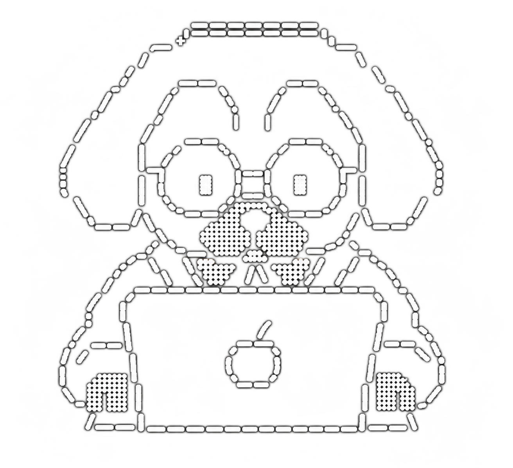

Desarrollador de aplicaciones móviles y web. Me gusta llevar una idea de principio a fin, diseñar la experiencia, construir la app, preparar todo lo que hay detrás y dejarla publicada en manos de usuarios reales. Hago software pensado para resolver problemas cotidianos, cuidando que sea simple, rápido y agradable de usar.

 

  STACK 
  <code>flutter</code> <code>dart</code> <code>supabase</code> <code>postgresql</code> <code>firebase</code> <code>typescript</code> <code>javascript</code> <code>node.js</code> <code>react</code> <code>docusaurus</code> <code>vercel</code> <code>android</code> <code>ios</code>
    
  EDICIÓN DIGITAL 
  <code>Adobe Illustrator</code> <code>Adobe Photoshop</code>

 

### Proyectos

| Proyecto | Descripción | Enlaces |
| --- | --- | --- |
| Mi Lotería Campechana | Aplicación de lotería campechana. | [Sitio web](https://www.miloteriacampechana.com/#/home) · [Google Play](https://play.google.com/store/apps/details?id=com.luxorapps.miloteriacampechana) |
| Portal UMMA (1000+ Usuarios) | Portal web de UMMA. | [Sitio web](https://www.portalumma.com.mx/) |
| Reproductor Luxor | Reproductor web. | [Sitio web](https://luxor117.neocities.org/reproductor_luxor) |
| El Rapidín — En desarrollo | Plataforma de entregas y servicios locales con sistema de créditos. | Próximamente |
