Desarrollador de aplicaciones móviles y web. Me gusta llevar una idea de principio a fin, diseñar la experiencia, construir la app, preparar todo lo que hay detrás y dejarla publicada en manos de usuarios reales. Hago software pensado para resolver problemas cotidianos, cuidando que sea simple, rápido y agradable de usar.

 

  STACK 
  <code>flutter</code> <code>dart</code> <code>supabase</code> <code>postgresql</code> <code>firebase</code> <code>typescript</code> <code>javascript</code> <code>node.js</code> <code>react</code> <code>docusaurus</code> <code>vercel</code> <code>android</code> <code>ios</code>
    
  EDICIÓN DIGITAL 
  <code>Adobe Illustrator</code> <code>Adobe Photoshop</code>

 

### Proyectos

| Proyecto | Descripción | Tecnologías |
| --- | --- | --- |
| 
 <strong>Mi Lotería Campechana</strong> <a href="https://www.miloteriacampechana.com/#/home">Sitio web</a> · <a href="https://play.google.com/store/apps/details?id=com.luxorapps.miloteriacampechana">Google Play</a>
 | Lotería digital con cantador automático con voz, cartillas personalizables y multijugador en tiempo real. Incluye creación e impresión de cartillas en PDF y un modo para eventos. | `Flutter` `Dart` `Supabase` `GoRouter` `Vercel`  Realtime Broadcast y Presence, acceso con Google OAuth, almacenamiento local y monetización con AdMob y AdSense. |
| Portal UMMA (1000+ Usuarios) [Sitio web](https://www.portalumma.com.mx/) | Portal web de UMMA. | — |
| Reproductor Luxor [Sitio web](https://luxor117.neocities.org/reproductor_luxor) | Reproductor web. | — |
| El Rapidín — En desarrollo Próximamente | Plataforma de entregas y servicios locales con sistema de créditos. | — |
