Desarrollador de aplicaciones móviles y web. Me gusta llevar una idea de principio a fin, diseñar la experiencia, construir la app, preparar todo lo que hay detrás y dejarla publicada en manos de usuarios reales. Hago software pensado para resolver problemas cotidianos, cuidando que sea simple, rápido y agradable de usar.

 

  STACK 
  <code>flutter</code> <code>dart</code> <code>supabase</code> <code>postgresql</code> <code>firebase</code> <code>typescript</code> <code>javascript</code> <code>node.js</code> <code>react</code> <code>docusaurus</code> <code>vercel</code> <code>android</code> <code>ios</code>
    
  EDICIÓN DIGITAL 
  <code>Adobe Illustrator</code> <code>Adobe Photoshop</code>

 

### Trayectoria

| Proyecto | Descripción | Tecnologías |
| --- | --- | --- |
| 
 <strong>Mi Lotería Campechana</strong> <a href="https://www.miloteriacampechana.com/#/home">Sitio web</a> · <a href="https://play.google.com/store/apps/details?id=com.luxorapps.miloteriacampechana">Google Play</a>
 | Lotería digital con cantador automático con voz, cartillas personalizables y multijugador en tiempo real. Incluye creación e impresión de cartillas en PDF y un modo para eventos. | `Flutter` `Dart` `Supabase` `GoRouter` `Vercel` `Google OAuth` `AdMob` `AdSense` |
| 
 <strong>Portal UMMA</strong> (1000+ Usuarios) <a href="https://www.portalumma.com.mx/">Sitio web</a>
 | Portal universitario para Android y web, con acceso para alumnos, docentes y personal.  Módulos: estudiantes, docentes, personal, control de asistencia, ciclos escolares, grados y áreas escolares, planes de estudio, materias, carga académica, salones, mobiliario, inventario, cobranza, eventos, talleres, transporte, seguridad y configuración. | `Flutter` `Dart` `Supabase` `SQLite` `Provider` `Riverpod` `GoRouter` `Firebase Cloud Messaging` `ML Kit` `TensorFlow Lite` `GPS` `Syncfusion` `Vercel` |
| 
 <strong>Reproductor Luxor</strong> <a href="https://luxor117.neocities.org/reproductor_luxor">Sitio web</a>
 | Reproductor de música inspirado en Windows 7 y Vista, con estética Frutiger Aero: transparencias, brillos y un CD animado con la portada de cada canción. Reproduce música de YouTube organizada por álbum y artista, con temas personalizables, estadísticas de escucha e importación y exportación de la biblioteca. | `HTML` `CSS` `JavaScript` `YouTube IFrame API` `LocalStorage` `IndexedDB` `Neocities` |
| El Rapidín — En desarrollo Próximamente | Plataforma de entregas y servicios locales con sistema de créditos. | — |
